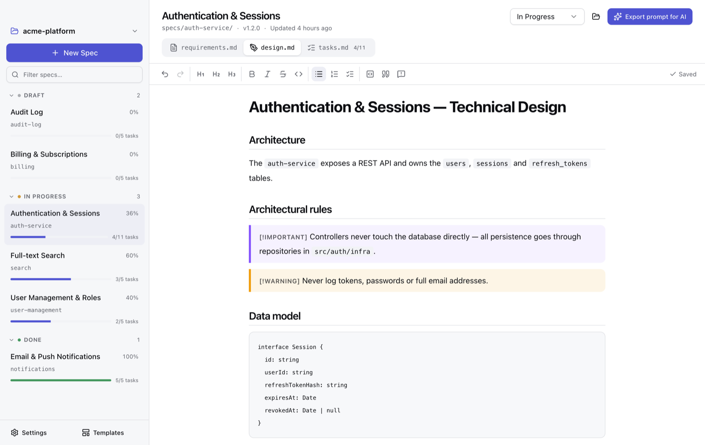
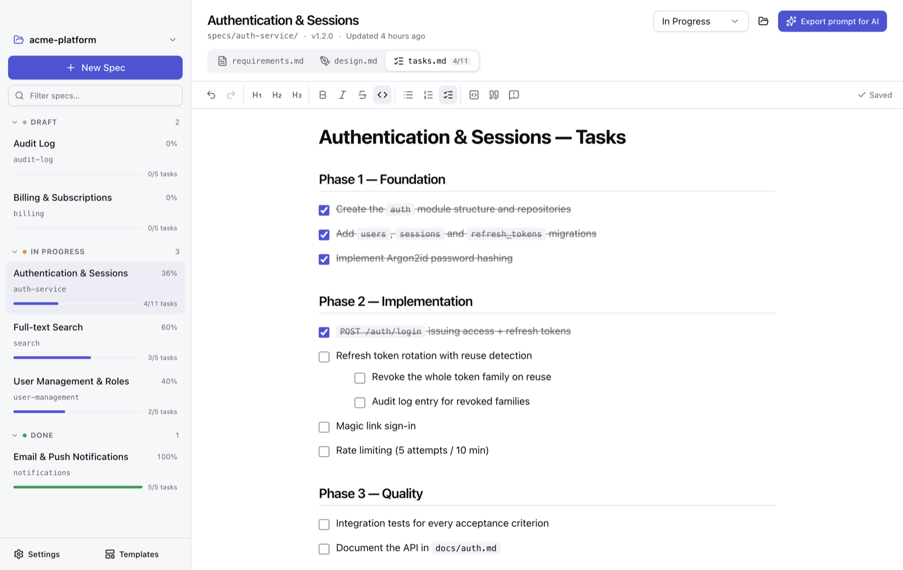
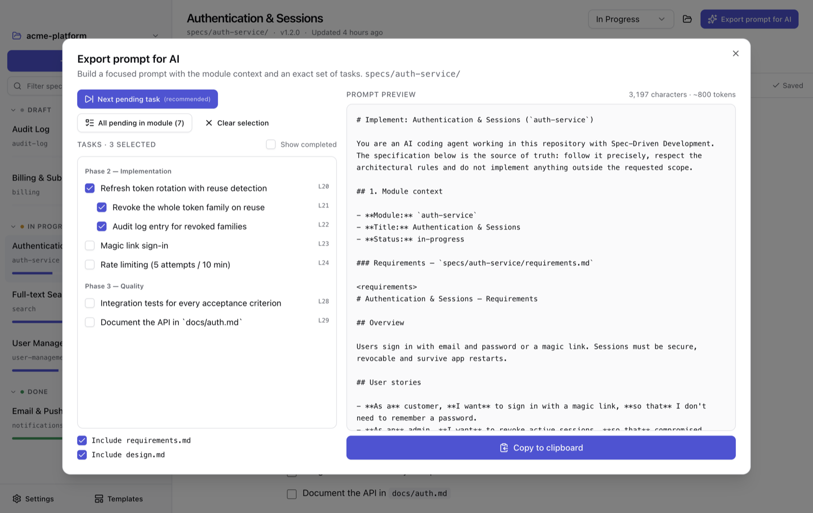
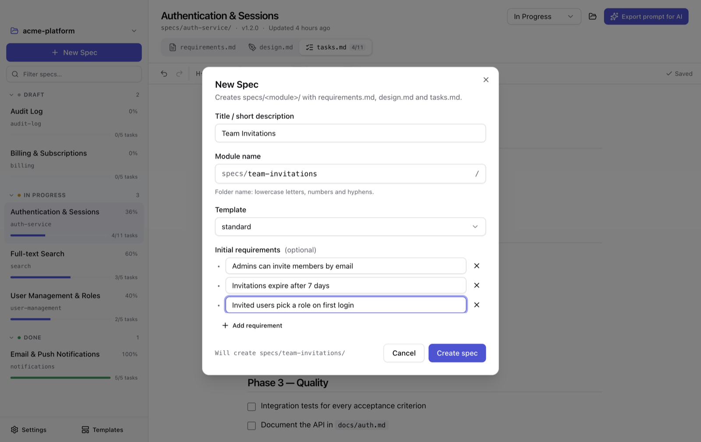
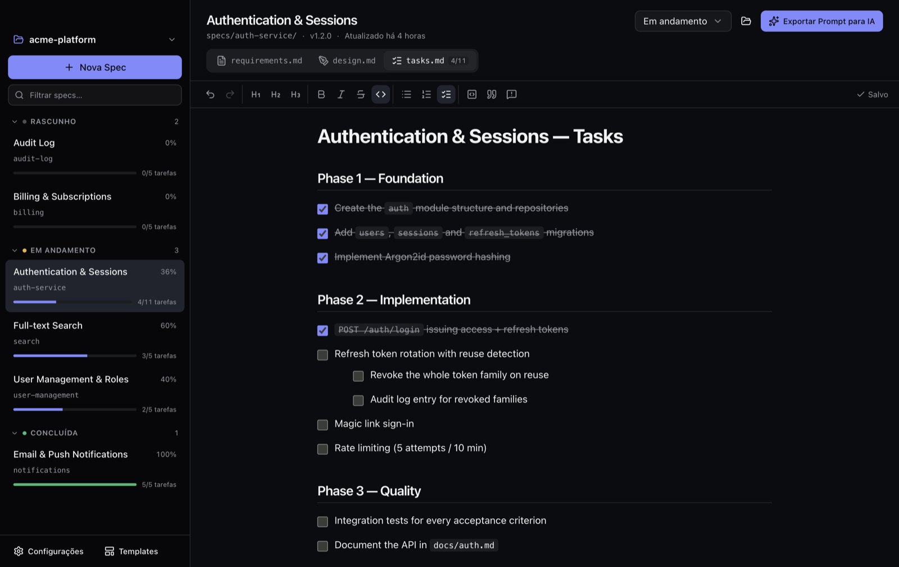

# SpecCraft

[](LICENSE)
[](https://buymeacoffee.com/vifilho)

Desktop app (Electron + React + TypeScript), **100% offline**, for **Spec-Driven Development**:
open a local repo, edit the `specs/<module>/{requirements,design,tasks}.md` trio in a Notion-style
editor that saves plain Markdown, and export granular prompts for AI coding agents
(Cursor, Claude Code, Cline, Aider, ChatGPT…).



## Screenshots

| Interactive `tasks.md` checklist | Export prompt for AI |
|---|---|
|  |  |
| **New Spec wizard** | **Dark theme · Português (Brasil)** |
|  |  |

- **Sidebar** — specs grouped by status (Draft / In Progress / Done) with a progress bar from `tasks.md`.
- **Editor** — WYSIWYG Markdown (TipTap): checklists, code blocks and GitHub-style callouts, saved as plain `.md`.
- **Export** — "next pending task" (recommended), "all pending" or manual batches; the prompt tells the agent to tick the exact checkbox in `tasks.md` when done.
- **i18n & themes** — pt-BR, English and Español; light, dark or system.

## Scripts

| Command | What it does |
|---|---|
| `npm run dev` | Run the app with hot reload |
| `npm run typecheck` | Strict TS check (main/preload and renderer) |
| `npm test` | Unit + integration tests (parser, prompt, frontmatter, Markdown round-trip, SpecService, watcher) |
| `npm run build` | Typecheck + production build to `out/` |
| `npm run dist` / `dist:mac` / `dist:win` / `dist:linux` | Package installers with electron-builder into `dist/` |

### Releases

Pushing a `v*` tag runs `.github/workflows/release.yml`, which builds macOS (dmg/zip, x64 + arm64),
Windows (NSIS) and Linux (AppImage/deb) installers and uploads them to a **draft** GitHub Release.
The tag must match `version` in `package.json`:

```sh
npm version patch        # bumps package.json and creates the tag, e.g. v0.1.1
git push --follow-tags
```

Then review the draft on GitHub and click **Publish release**. Builds are currently unsigned.

> npm ≥ 11 blocks install scripts by default; `package.json` already allows the ones `electron`
> needs to download its binary. If `node_modules/electron/dist` is missing, run `npm approve-scripts electron`.

## Project layout

```
src/
  shared/      Pure, tested logic shared by all processes
    types.ts       Domain types (SpecSummary, SpecFile, Settings, FsEvent…)
    ipc.ts         Typed IPC contract: channel → [args, result]
    frontmatter.ts YAML frontmatter split/patch (preserves comments & key order)
    tasks.ts       Checklist parser (nesting, sections, fenced code ignored), progress, selections
    prompt.ts      Deterministic AI prompt builder
    slug.ts        Module name validation/slugify (portable, Windows-reserved names)
  main/        Electron main process — the only place that touches the disk
    index.ts         Window, security (sandbox, CSP, offline network block), single instance
    ipc.ts           ipcMain.handle registrations (errors returned as data with codes)
    spec-service.ts  Project/specs/templates operations, optimistic concurrency, path guards
    watcher.ts       chokidar watcher, debounced, ignores the app's own writes
    settings-store.ts JSON settings in userData (language, theme, recents)
    builtin-templates.ts Localized built-in templates (standard, minimal)
  preload/     contextBridge API (`window.api`)
  renderer/    React UI (Tailwind 4 + shadcn/ui on Radix, TipTap, i18next, zustand)
```

## How it works

- **Disk is the source of truth.** The editor edits only the Markdown body; frontmatter is kept
  (comments included) and `updated_at` is refreshed on every save. Writes are atomic (temp file + rename).
- **Concurrency.** Each save sends the file's last known `mtime`; if the file changed on disk the
  save fails with `CONFLICT` and the editor offers *Reload from disk* / *Keep my version*. Clean
  editors reload silently on external changes. Deleted files show a *Restore* banner; removed or
  renamed modules are detected and the sidebar refreshes.
- **Templates.** Built-ins ship in pt-BR/en/es. Project templates live in
  `specs/.templates/<name>/{requirements,design,tasks}.template.md` (placeholders `{{module}}`,
  `{{title}}`, `{{date}}`, `{{requirements}}`; optional frontmatter is merged into generated files).
  *Templates → Customize* copies a built-in into the project.
- **Callouts.** GitHub alerts (`> [!NOTE]`, `[!TIP]`, `[!IMPORTANT]`, `[!WARNING]`, `[!CAUTION]`)
  render as styled blocks while staying plain Markdown on disk.
- **Offline.** No network calls; the main process cancels any non-local request and the CSP blocks
  remote connections.

## Support

SpecCraft is free and open source. If it saves you time, you can support its development:

<a href="https://buymeacoffee.com/vifilho" target="_blank"></a>

Bug reports, ideas and pull requests are welcome too.

## License

[MIT](LICENSE) © 2026 Vilmar Bispo Filho
